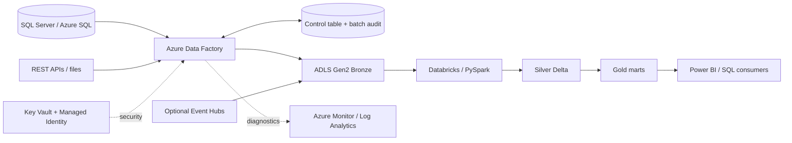

# FinNova Bank — Azure Data Engineering Portfolio

A hands-on portfolio project demonstrating metadata-driven ingestion with Azure Data Factory (ADF), ADLS Gen2 Bronze/Silver/Gold layers, Databricks/PySpark, Delta Lake, SCD Type 2, data quality, recovery, and monitoring.

> This is a learning/portfolio project. The ADF JSON is an illustrative template, not a live factory export. Replace placeholders and test in your own environment. Do not represent simulated work as employer production experience.

## Architecture

## Stack
Azure Data Factory, ADLS Gen2, Azure Databricks, PySpark, Delta Lake, SQL Server/Azure SQL, optional Event Hubs, Managed Identity, Key Vault, RBAC/ACLs, Azure Monitor, Log Analytics/KQL, GitHub.

## Main design choices
1. Metadata-driven ADF pipeline reads active source configurations and loops through them.
2. Incremental ingestion uses a committed watermark and fixed upper bound where possible.
3. Batch audit tracks batch ID, source, window, status, row counts, and errors.
4. Watermark advances only after successful write and validation.
5. Delta `MERGE`, deterministic deduplication, and stable batch IDs make retries idempotent.
6. Bronze preserves raw data; Silver cleans and validates; Gold serves business aggregates.
7. A short lookback cannot catch arbitrarily late records; use CDC/change tracking where possible plus periodic reconciliation/backfill.
8. Use Managed Identity and Key Vault references; never commit secrets or real customer data.

## Repository layout
- `docs/`: architecture, 16-day roadmap, operations runbook, interview walkthrough, GitHub upload guide
- `sql/`: control tables, synthetic source schema, validation queries
- `databricks/`: Bronze-to-Silver, Silver-to-Gold, SCD Type 2 examples
- `adf/`: illustrative pipeline JSON and expression notes
- `monitoring/`: KQL examples
- `tests/`: PySpark data-quality assertions

## Quick start
1. Read the docs.
2. Run SQL scripts in a development database only.
3. Replace storage/catalog/schema placeholders in PySpark files.
4. Create linked services, datasets, and integration runtime references in your ADF factory; use the JSON as a design reference.
5. Run quality checks and reconcile Source → Bronze → Silver → Gold.

## Limitations
SQL records are synthetic. ADF JSON is not guaranteed to import directly; exact exports depend on your factory objects. Review every file for secrets, private endpoints, account details, and personal information before publishing publicly.
